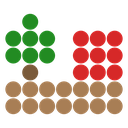

# LiDAR AI Classifier

<p align="center"></p>

Deep-learning semantic segmentation of airborne, mobile mapping and railway
LiDAR (LAS / LAZ / COPC) inside QGIS 3.34+ and QGIS 4, with three classifiers:

- **Airborne classifier**: LitePT-L Airborne, a point transformer from
  [prs-eth/LitePT](https://github.com/prs-eth/LitePT) using 10 cm voxels and
  eight classes, on NVIDIA GPUs. On computers where LitePT-L cannot run (no
  NVIDIA GPU, Apple Silicon) it uses its second engine,
  SegFormer 3D (UrbanFiltering, [TreeAIBox](https://github.com/NRCan/TreeAIBox),
  Natural Resources Canada), a voxel transformer at 30 cm that also runs on the
  CPU. The dock and the log say which engine runs.
- **Mobile mapping classifier**: LitePT-L Mobile Mapping, the same
  architecture with 5 cm voxels. Nine classes (ground, low vegetation,
  high vegetation, building, pole-like, vehicle, fence/barrier, wire, unknown),
  XYZ only, with editable output codes. NVIDIA GPU required.
- **Railway classifier** (new in 1.3): LitePT-L Railway, 5 cm voxels. Seven
  classes (ground and track bed, rail, pole, wire, vegetation, fence, other),
  XYZ only, with editable output codes. NVIDIA GPU required.

Until version 1.1 the plugin was called **Aerial LiDAR Classifier**. The
installation folder is still `Aerial_LiDAR_Classifier`, so an update keeps
saved settings, downloaded weights and Processing models.

[](https://qgis.org)
[](https://www.python.org)
[](LICENSE)
[](#model-weights)
[](#hardware-and-platform-support)

Every input point is written back with a LAS classification code. The airborne
classifier uses the [ASPRS LAS 1.4](https://www.asprs.org/divisions-committees/lidar-division/laser-las-file-format-exchange-activities)
codes. The mobile mapping and railway classifiers use ASPRS codes where they
exist (rails get the ASPRS *Rail* code 10) and the first user-definable codes,
from 64 up, for the rest; every code is editable.
The classified output is an ordinary LAS or LAZ file. For QGIS builds that
reject files with existing extra attributes, the plugin can prepare a COPC
viewing copy when loading the result.

> **Learn it with the author.** Abderrazzaq Kharroubi, who wrote this plugin,
> teaches *LiDAR Point Clouds Processing in QGIS*, a live cohort on
> classification, terrain models, COPC and 3D editing.
> [See the syllabus and the next dates](https://maven.com/geomatics/qgis3d?utm_source=github&utm_medium=readme&utm_campaign=qgis3d).
> The course is optional and paid; the plugin is and stays free.

---

## Table of contents

- [Features](#features)
- [Installation](#installation)
- [Quick start](#quick-start)
- [Usage](#usage)
- [Hardware and platform support](#hardware-and-platform-support)
- [Classification output](#classification-output)
- [Coordinate units](#coordinate-units)
- [Tiling, streaming and large files](#tiling-streaming-and-large-files)
- [How it works](#how-it-works)
- [Troubleshooting](#troubleshooting)
- [Model weights](#model-weights)
- [Citation](#citation)
- [License](#license)
- [Credits](#credits)
- [Development](#development)

---

## Features

- **Three classifiers, one interface.** Pick Airborne, Mobile mapping or
  Railway in the dock or with the `CLASSIFIER` parameter in Processing. If the
  selected classifier cannot run on the computer, the dock says why; the
  Airborne classifier then runs its SegFormer 3D engine and says so.
- **Your class codes for mobile mapping and railway.** Each class gets the
  code you choose (0 to 255), saved per classifier, or merged with another
  class by giving both the same code. The editor shows the ASPRS meaning of
  every code.
- **Nothing to install by hand.** On first use a Setup panel downloads a
  portable Python, PyTorch and the LiDAR libraries into a per-user folder
  (no admin rights), then the model weights. QGIS's own Python is left alone.
- **Weights download by themselves.** Setup fetches them; a model used for the
  first time (dock, Processing or `qgis_process`) fetches whatever is missing.
  Every file is checked against its published SHA-256 before each use.
- **Right PyTorch build for the GPU.** The NVIDIA driver and compute
  capability are read with `nvidia-smi` and the matching CUDA build of PyTorch
  is installed (`cu118` to `cu128`, `cu126` preferred), plus `spconv` for
  LitePT-L (on RTX 50 series its CUDA 12.6 build, which the NVIDIA driver
  compiles for the GPU on first use). Without an NVIDIA GPU the CPU build is
  installed. Apple Silicon
  uses MPS (the Airborne classifier's SegFormer 3D engine).
- **Units handled.** Files in feet are converted from their CRS before
  inference; see [Coordinate units](#coordinate-units).
- **Large files.** Spatial tiling with a context buffer, and a streaming mode
  for files larger than RAM.
- **Processing algorithm** usable from the Toolbox, the Graphical Modeler and
  the `qgis_process` command line.
- **Safe output.** Results are written to a temporary file and published only
  when complete; a batch can never overwrite one of its own inputs.
- **Background execution** with progress, cancel and optional loading of the
  results as point-cloud layers.

---

## Installation

### From the QGIS plugin repository (recommended)

1. *Plugins > Manage and Install Plugins...*
2. Search for **LiDAR Classifier** (the plugin was called *Aerial LiDAR
   Classifier* before version 1.2).
3. Click **Install Plugin**.

### From source

```bash
git clone https://github.com/akharroubi/AerialLidarClassifier.git Aerial_LiDAR_Classifier
```

The folder must be named `Aerial_LiDAR_Classifier` (the plugin's package name).
Copy it into your QGIS plugins directory, restart QGIS and enable it in the
plugin manager:

| OS      | QGIS 3 plugins directory |
|---------|--------------------------|
| Windows | `%APPDATA%\QGIS\QGIS3\profiles\default\python\plugins\` |
| macOS   | `~/Library/Application Support/QGIS/QGIS3/profiles/default/python/plugins/` |
| Linux   | `~/.local/share/QGIS/QGIS3/profiles/default/python/plugins/` |

QGIS 4 uses the same paths with `QGIS4` in place of `QGIS3`.

### First launch

The first time you open the plugin, a **Setup** panel shows what it will do
and which models the computer will get. One click on *Install Dependencies*
downloads:

- a standalone Python interpreter (~30 MB) and
  [`uv`](https://github.com/astral-sh/uv), a fast package installer,
- PyTorch and the LiDAR packages (~1 to 3 GB depending on CUDA), plus `spconv`
  (~100 MB) on NVIDIA GPUs,
- the model weights: LitePT-L Airborne, Mobile Mapping and Railway (~172 MB
  each) on NVIDIA GPUs, SegFormer 3D (~18 MB) everywhere.

It usually takes 5 to 15 minutes, and QGIS stays usable meanwhile. Everything
is stored under `~/.qgis_aerial_lidar_classifier/` (the weights under the
QGIS profile) and can be removed at any time.

If the GPU installation fails, the Setup panel offers **Install the CPU version
instead** (the Airborne classifier with SegFormer 3D on the CPU). The plugin
never switches from GPU to CPU by itself.

---

## Quick start

1. Click the plugin's toolbar icon (or *Plugins > LiDAR AI Classifier*).
2. Drag `.las` / `.laz` / `.copc.laz` files into the input list, or pick point
   cloud layers already loaded in the project.
3. Choose the classifier for the acquisition: **Airborne** for aerial LiDAR,
   **Mobile mapping** for street mobile mapping (vehicle, backpack) data,
   **Railway** for railway corridors. For mobile mapping and railway,
   *Class codes: Edit output codes...* sets the code of each class.
4. Choose an output folder (it defaults to the folder of the first file).
5. Click **Run classification**.

The line above the progress bar always says what is still missing before Run,
or what Run will do. When a run ends, the QGIS message bar shows the elapsed
time and an *Open folder* button.

---

## Usage

### Dock panel

- **Classifier strip** (top): the classifier selector, its status (ready,
  weights download on first run, needs an NVIDIA GPU, LitePT dependencies
  missing, or the engine in use when the Airborne classifier runs SegFormer 3D),
  the compute device, and a folder icon to import a weights file on offline
  machines.
- **Input files**: drop list, *Add files*, *Add folder*, and the loaded-layer
  pickers.
- **Output**: folder, filename suffix (default `_classified`), label field
  (default `classification`; Airborne only), *Class codes: Edit output
  codes...* (Mobile mapping and Railway), and *Load classified files in QGIS*.
- **Advanced parameters** (collapsed): *Use GPU*, *Clear GPU memory*, *GPU
  memory allocator* (automatic, expandable segments or standard; see
  [Troubleshooting](#cuda-driver-error-at-the-first-gpu-allocation)), *Tile
  large files* (auto size or tile size in metres, buffer in metres; files
  larger than the free memory are streamed from disk automatically), and
  *Input units*.
- **Log** (always visible) and the footer with progress, *Cancel* and *Run*.

### Processing algorithm

The algorithm *Classify LiDAR point cloud*, `aeriallidar:classify_point_cloud`,
is available from the **Processing Toolbox**, the **Graphical Modeler** (the
classified file is the `OUTPUT_FILE` output, ready to chain) and the
`qgis_process` command line:

```bash
qgis_process run aeriallidar:classify_point_cloud -- \
  INPUT=/data/tile.laz OUTPUT_FOLDER=/data/classified \
  CLASSIFIER=0 TILE_ENABLED=true TILE_SIZE_M=0 TILE_BUFFER_M=50
```

| Parameter | Values |
|-----------|--------|
| `INPUT` | LAS, LAZ or COPC file |
| `CLASSIFIER` | `0` Airborne, `1` Mobile mapping, `2` Railway |
| `OUTPUT_FOLDER`, `SUFFIX` | output location, default suffix `_classified` |
| `DEVICE` | `0` Auto, `1` GPU (CUDA), `2` CPU, `3` GPU (Apple MPS) |
| `FIELD_NAME` | `classification` (default). The Airborne classifier also accepts a new name (raw model classes in an extra field) |
| `OUTPUT_CODES_JSON` | mobile mapping and railway, optional: codes keyed by model class ID, e.g. `{"5":70,"6":71,"7":72}`; blank keeps the defaults |
| `LOAD_AS_LAYER` | add the result to the project |
| `TILE_ENABLED`, `TILE_SIZE_M`, `TILE_BUFFER_M` | tiling; size `0` is automatic (about 10 M points per tile); buffer `0` (default) is the context the model needs, with which tiles give the same labels as an untiled run |
| `TILE_STREAMING` | always stream from disk; otherwise a file is streamed automatically when it does not fit in RAM |
| `UNITS` | `0` auto-detect, `1` metres, `2` international feet, `3` US survey feet |

For example, mobile mapping with your own user-defined codes for poles,
vehicles and fences:

```bash
qgis_process run aeriallidar:classify_point_cloud -- \
  INPUT=/data/street.laz OUTPUT_FOLDER=/data/classified CLASSIFIER=1 \
  'OUTPUT_CODES_JSON={"5":70,"6":71,"7":72}'
```

or railway, with fences written as 70 and other objects as 71 (both
user-defined codes):

```bash
qgis_process run aeriallidar:classify_point_cloud -- \
  INPUT=/data/line.laz OUTPUT_FOLDER=/data/classified CLASSIFIER=2 \
  'OUTPUT_CODES_JSON={"6":70,"7":71}'
```

With the Airborne classifier the log names the engine that ran, and why when
it is SegFormer 3D. The weights download automatically on the first run of a
model. The dependencies themselves are installed once from the dock's Setup
panel.

**Scripts and models from versions 1.0 to 1.2** keep working: they use the
algorithm `aeriallidar:classify_lidar`, whose `MODEL` parameter selects one
model by index (`0` LitePT-L Airborne, `1` SegFormer 3D Airborne, `2` LitePT-L
Mobile Mapping, and now `3` LitePT-L Railway) and runs exactly that model. It is
hidden from the Toolbox but still runs from saved models, Python and
`qgis_process`, and a saved model step keeps its model when edited.

---

## Hardware and platform support

| Environment | Status for 1.3.0 |
|-------------|------------------|
| Windows 10, QGIS 3.44.10 LTR (Qt 5.15), Python 3.12, RTX 3090 | Tested: the three classifiers and all four models on CUDA, the Airborne classifier's SegFormer 3D engine on the CPU, dock, Processing, Graphical Modeler, `qgis_process`, data-integrity suite |
| Windows 10, QGIS 4.2.2 (Qt 6.11, PyQt 6.11), Python 3.12, RTX 3090 | Tested: the same as QGIS 3.44 |
| Linux x86_64 (Ubuntu under WSL), Python 3.10 | Installer and runtime tested outside the QGIS GUI |
| macOS, Apple Silicon (MPS) | Code path present, not tested; reports welcome |
| GPUs under 8 GB, other GPU generations | Not tested on real hardware; a smaller-crop path and out-of-memory retries exist |

**LitePT-L needs an NVIDIA GPU and compatible PyTorch and `spconv` packages.**
The installer selects the `spconv` build matching its `cu118`, `cu121`, `cu124`
and `cu126` setup paths. RTX 50 series GPUs (Blackwell) need the `cu128`
PyTorch, for which `spconv` publishes no build; the installer adds the `cu126`
build there, and the NVIDIA driver compiles its kernels for the GPU the first
time a LitePT-L model runs (10 to 30 s, reported in the log, then cached by the
driver). An environment set up by 1.3.1 or earlier on such a GPU is completed
in place at the next start (nothing is re-downloaded). The dock checks the
installed packages and reports why a selected classifier is unavailable. The
Airborne classifier then runs its SegFormer 3D engine; the Mobile mapping and
Railway classifiers need LitePT-L.

**GPU memory allocator.** For the LitePT-L models the plugin selects PyTorch's
allocator. In the automatic mode (default) it uses the standard allocator on
Windows, where some GPU drivers refuse expandable segments intermittently, and
on drivers without CUDA virtual memory management (shared vGPU profiles such as
an A10-8Q). Elsewhere it uses expandable segments, which keep the reserved
memory close to what is used; if the driver still refuses them during a run,
the run switches to the standard allocator and retries, and later runs on that
GPU start with it. Both allocators give identical labels; the standard one
reserves about twice as much GPU memory (for example 4.2 GB instead of 2.0 GB
for Mobile Mapping on an 8 GB card), without out-of-memory retries on 6, 8 or
12 GB cards. The run log says which allocator served the run, in a line
starting with `CUDA memory:`. *Advanced parameters > GPU memory allocator*
fixes the choice; scripts and `qgis_process` can set
`AERIAL_LIDAR_CLASSIFIER_CUDA_ALLOCATOR` to `auto`, `expandable` or `standard`.
A `PYTORCH_CUDA_ALLOC_CONF` of your own is respected in automatic mode.

LitePT-L Airborne processes crops of up to 70,000 points within 30 m; cards
under 8 GB use 35,000-point / 20 m crops. LitePT-L Mobile Mapping and
LitePT-L Railway process crops of up to 240,000 points within 12 m; cards
under 16 GB use 120,000 points / 9 m and cards with 8 GB or less 50,000
points / 6 m. A crop that runs
out of memory is retried with half as many points, down to 5,000. Smaller crops give
the model less context and can change a few labels; the log says when a
reduced budget is used. Memory use and processing speed depend on the input
and hardware.

**SegFormer 3D** (the Airborne classifier's second engine) runs on the CPU,
on NVIDIA GPUs and (untested) on Apple MPS. On the CPU it is much slower than
on a GPU but works on any computer.

You never need to install CUDA yourself: the PyTorch wheels carry it.

---

## Classification output

With the default `classification` field, points get the codes below.

**Railway classifier**, LitePT-L Railway (editable codes):

| Model class | Name       | Default code | Meaning |
|------------:|------------|-------------:|---------|
| 1           | Ground     | 2            | Ground (terrain, track bed, ballast, sleepers, platforms, roads) |
| 2           | Rail       | 10           | Rail (running rails) |
| 3           | Pole       | 15           | Transmission Tower (catenary masts, portals, cantilevers, utility poles) |
| 4           | Wire       | 14           | Wire, Conductor (contact and messenger wires, droppers, feeders, power and telecom lines) |
| 5           | Vegetation | 5            | High Vegetation (trees, shrubs and low vegetation) |
| 6           | Fence      | 64           | user-defined (fences, noise barriers, guardrails) |
| 7           | Other      | 1            | Unclassified (buildings, signals, signs, cabinets, trains, vehicles, people) |

ASPRS LAS 1.4 has a *Rail* class (10), and masts and poles carry the overhead
conductors as a *Transmission Tower* (15) does, so these codes are used by
default. There is no ASPRS code for fences: they get 64, the first
user-definable code.

**Mobile mapping classifier**, LitePT-L Mobile Mapping (editable codes):

| Model class | Name            | Default code | Meaning                         |
|------------:|-----------------|-------------:|---------------------------------|
| 1           | Ground          | 2            | Ground                          |
| 2           | Low vegetation  | 3            | Low Vegetation                  |
| 3           | High vegetation | 5            | High Vegetation                 |
| 4           | Building        | 6            | Building                        |
| 5           | Pole like       | 64           | user-defined (poles, lamp posts, signs, traffic lights) |
| 6           | Vehicle         | 65           | user-defined (cars, vans, trucks, buses) |
| 7           | Fence barrier   | 66           | user-defined (fences, railings, guardrails, barriers) |
| 8           | Wire            | 14           | Wire, Conductor                 |
| 9           | Unknown         | 1            | Unclassified (street furniture, pedestrians, bicycles...) |

ASPRS LAS 1.4 has no code for poles, vehicles or fences, so they get the
first codes of the user-definable range 64 to 255 by default.

To change any code, choose the Mobile mapping or Railway classifier and click
*Class codes: Edit output codes...*: the table takes values from 0 to 255,
shows the ASPRS meaning of each value, is saved per classifier, and *Reset to
model defaults* restores it. Giving two classes the same code merges them (for
example vehicles and unknown both to 1). In Processing, pass the codes as
`OUTPUT_CODES_JSON` keyed by model class, for example `{"5":70,"6":71,"7":72}`;
omitted classes keep their default, and the dock's saved table is not used.

The mobile mapping and railway classifiers always write to the
`classification` field. Codes above 31 need LAS 1.4; legacy files are upgraded
automatically (see below).

**Airborne classifier**, LitePT-L Airborne engine:

| Model class | Name        | ASPRS code | Meaning              |
|------------:|-------------|-----------:|----------------------|
| 1           | Ground      | 2          | Ground               |
| 2           | Vegetation  | 5          | High Vegetation      |
| 3           | Cars        | 1          | Unclassified \*      |
| 4           | Trucks      | 1          | Unclassified \*      |
| 5           | Power lines | 14         | Wire, Conductor      |
| 6           | Fences      | 1          | Unclassified \*      |
| 7           | Poles       | 15         | Transmission Tower   |
| 8           | Buildings   | 6          | Building             |

**Airborne classifier**, SegFormer 3D engine (UrbanFiltering classes):

| Model class | Name        | ASPRS code | Meaning              |
|------------:|-------------|-----------:|----------------------|
| 1           | Ground      | 2          | Ground               |
| 2           | Vegetation  | 5          | High Vegetation      |
| 3           | Vehicles    | 1          | Unclassified \*      |
| 4           | Wiring      | 14         | Wire, Conductor      |
| 5           | Fence       | 1          | Unclassified \*      |
| 6           | Pole        | 15         | Transmission Tower   |
| 7           | Building    | 6          | Building             |

\* ASPRS LAS 1.4 has no codes for vehicles or fences. To keep them apart with
the Airborne classifier, set the label field to a new name (for example
`ai_label`): the model's own class numbers above are then written to that
extra field, and the input's `classification` is kept unchanged. Standard LAS
dimension names (`X`, `intensity`, `red`...) are refused as label fields.

What the output keeps:

- the same number of points, in the same order, with the same coordinates,
  scales, offsets, CRS, VLRs and EVLRs, and every other attribute byte for
  byte (including scaled 64-bit extra bytes);
- the input's format: LAS in gives LAS out, LAZ or COPC in gives LAZ out (a
  COPC input becomes ordinary LAZ, since its spatial index would no longer
  match);
- the point format, unless a code above 31 needs LAS 1.4 (formats 0/1 become
  6, 2/3 become 7, 4 becomes 9, 5 becomes 10; RGB is kept). The legacy scan
  angle becomes the LAS 1.4 scan angle (rounded to at most 0.003 degrees); the
  mobile mapping and railway classifiers add no extra dimension, the airborne
  classifier also keeps the original value in a `scan_angle_rank` extra field.

A small VLR (`AerialLiDAR`, record 1) records the model, its weights hash, the
field and the class mapping. Files that carry waveform packets are refused
(their relocation is not supported): export a point-only copy first.
Truncated files are refused instead of producing a shorter output.

Some QGIS builds refuse to open valid LAS 1.4 files that carry extra
dimensions (seen with the PDAL reader of QGIS 3.44). When *Load classified
files in QGIS* is ticked and the output keeps extra dimensions from the input,
the plugin also writes a viewing copy, `<output>.<id>.qgis-view.copc.laz`,
with QGIS's own Untwine, checks its point count, bounds and class counts, and
loads that copy instead. The classified LAS/LAZ (and the Processing
`OUTPUT_FILE`) is the result to keep: the viewing copy reorders points for its
spatial index and can be deleted at any time. If Untwine is missing or fails,
the log says why and the classified file is unaffected.

---

## Coordinate units

The models work in **metres**. Most US LiDAR is delivered in US survey feet;
fed to a model unconverted, every distance is 3.28 times too small, buildings
come out as *Wire, Conductor* and *Transmission Tower*, and the run is about 13
times slower.

The plugin reads the linear unit from the file's CRS (the WKT record of LAS 1.4
files, or the GeoTIFF keys of older files, including a vertical CRS code),
converts XY and Z to metres **for the model only**, and logs what it found:

```
tile.las: coordinate units: XY in US survey foot, Z in US survey foot
(WKT CRS: US survey foot horizontal, US survey foot vertical); converting to metres for the model
```

The output keeps the original coordinates, scales and CRS.

- Without a CRS in the header, metres are assumed and the log says so.
- When the CRS has no vertical part, Z is assumed to share the horizontal unit.
- Geographic files (degrees) are refused, even with a units override: reproject
  them first, for example to the local UTM zone.

To force a unit when the header is missing or wrong, use *Advanced parameters >
Input units* in the dock (auto-detect, metres, international feet, US survey
feet) or the `UNITS` parameter in Processing.

---

## Tiling, streaming and large files

- **Tile large files** splits the file into square tiles with a context
  buffer; only the core of each tile is written. Tile size is automatic (about
  10 M points per tile at the file's average density) or set in metres. The
  file is read into RAM once and the model works on one tile at a time.
- **Tiling does not change the labels.** Every tile places the model's crops
  (LitePT-L) or blocks (SegFormer 3D) on the same grid as an untiled run of
  the whole file, and the buffer is, by default, exactly the context the
  model needs: 91.5 m for Airborne LitePT-L, 35 m for Mobile mapping and
  Railway (less on GPUs under 16 GB, where the crops are smaller), 34 m for
  SegFormer 3D. Measured on a 1.08 M-point street tile cut into 100 m tiles:
  identical labels to the untiled run for LitePT-L Airborne and Mobile
  Mapping and for SegFormer 3D. A buffer set larger is used as given; a smaller one is raised to
  the model's need.
- **Streaming is automatic.** Before each file the plugin reads its header and
  compares the memory an in-memory run needs (the point records, the
  coordinates and one tile) with the memory free at that moment. A file that
  does not fit is streamed from disk: read in chunks, the points of each tile
  kept in temporary files, one tile classified at a time, the output written
  as it goes, about 2 bytes per point in RAM for the whole file. A file meant
  to run in one piece (tiling unticked) that does not fit in one piece is
  tiled automatically. The log says when either happens. The temporary tile
  files take about 32 bytes per point (more with the buffers) in a work folder
  inside the output folder, on the drive you chose for the results, and are
  removed at the end; the run checks the free space of that drive before it
  starts and says how much it needs. In Processing, `TILE_STREAMING` forces
  streaming.
- **Dense tiles are split.** Point density is rarely uniform: along a mobile
  mapping trajectory a tile sized from the average density can hold twenty
  times more points than its neighbours. While reading the file, the plugin
  counts the points on a fine grid, and every tile whose buffered window holds
  more points than half of the free RAM allows is cut in two, recursively,
  across the densest direction, before inference. The log says how many tiles
  were split. Splitting stops when the model's context around a piece holds
  most of its points; if such a piece is still over the budget, the log says
  so and the run continues.

The predictions take about 2 bytes per point for the whole file. Run one job
at a time on very large data, and untick *Load classified files in QGIS* for
long batches.

To keep the GPU free for other work, choose the Airborne classifier and untick
*Use GPU*: its SegFormer 3D engine then runs on the CPU. *Clear GPU memory* releases unused cached memory
between runs.

---

## How it works

**LitePT-L Airborne** works on points. Per tile the plugin removes an integer origin,
keeps one representative per occupied 10 cm voxel (with an exact map back to
every raw point), and covers the representatives with crops of at most 70,000
points within 30 m. Each crop is centred, floor-referenced and voxelised;
the network's class probabilities are averaged over every
visit of a point, and the best class is projected back to the raw points. The
upstream code (MIT) is vendored in `core/litept/` with pure-PyTorch replacements
for FlashAttention, `torch_scatter` and the RoPE kernel, so only `spconv` is a
compiled dependency.

**SegFormer 3D** is the UrbanFiltering 3D SegFormer
([Xi et al., TreeAIBox](https://github.com/NRCan/TreeAIBox)). Points are
voxelised on a 0.3 x 0.3 x 0.2 m grid (occupancy only), the grid is cut into
overlapping blocks of 112 x 112 x 256 voxels, the network labels every occupied
voxel (7 classes), and each point takes the label of its voxel.

**LitePT-L Mobile Mapping** and **LitePT-L Railway** use the same
architecture and the same steps with 5 cm voxels and crops of at most 240,000
points within 12 m (centres 11 m apart), one pass. Their features are
geometric only (height above the crop), so intensity, colour and returns are
not needed.

The **Airborne classifier** runs LitePT-L Airborne when the computer can (NVIDIA
CUDA GPU, *Use GPU* ticked, `spconv` loaded) and SegFormer 3D otherwise. The
VLR of each output records which model wrote it.

All models run inside a QGIS background task, so QGIS stays responsive.

### Railway classifier: scope and limits

- Made for railway corridors scanned by mobile mapping systems (train-mounted
  or similar). Dense helicopter LiDAR and static terrestrial scans of tracks
  and stations gave usable results in visual checks.
- Not tested on sparse airborne LiDAR (below about 50 points/m²) or in tunnels.
- Fences that stand in hedges, and barriers that look like fences, are the
  hardest class: check them where they matter.
- *Other* collects every remaining object (buildings, signals, cabinets,
  trains...), so it is a broad class.
- Very large files: use tiling (a buffer of 10 m or more keeps context at the
  tile edges) or streaming.
- The results are provided as is, without warranty (see the licences). Check
  them before using them for asset management, maintenance planning or any
  safety-related work.

---

## Troubleshooting

Every install and detection step is logged in *View > Panels > Log Messages*
under the **LiDAR AI Classifier** tag: start there.

### Repair or reinstall the dependencies

*Plugins > LiDAR AI Classifier > Repair dependencies* opens the Setup panel.
If the classifier was already used in this QGIS session, restart QGIS first
(Windows keeps the loaded libraries locked), then run Repair before opening the
classifier.

### The GPU installation failed

Update the NVIDIA driver from
[nvidia.com](https://www.nvidia.com/Download/index.aspx) (Game Ready or Studio
driver, not a partial driver from Windows Update) and click *Reinstall
Dependencies*, or click *Install the CPU version instead*.

### "Needs an NVIDIA GPU", "GPU use is switched off", "LitePT dependencies missing" or "SegFormer 3D engine"

The LitePT-L models run only on NVIDIA GPUs, with the `spconv` library of the
plugin's environment. Where they cannot run, the Mobile mapping and Railway
classifiers are unavailable and the Airborne classifier uses SegFormer 3D; the
status tooltip and the log say why.

- *GPU use is switched off*: tick *Use GPU* in *Advanced parameters*.
- *PyTorch is CPU-only*: run *Plugins > LiDAR AI Classifier > Repair
  dependencies*, leave the CPU option unticked, and restart QGIS.
- *LitePT dependencies missing*: the status tooltip and the dock log name the
  library that failed to load and the PyTorch/CUDA build in use. Restart QGIS,
  run *Repair dependencies*, restart again. If it persists, open an issue with
  that log text.
- RTX 50 cards (Blackwell): the plugin installs `spconv`'s `cu126` build next
  to the `cu128` PyTorch. If the environment was set up by 1.3.1 or earlier,
  the Setup dock opens with *Add missing packages*: it adds `spconv` to the
  existing environment. The first LitePT-L run then compiles the kernels for
  the GPU (10 to 30 s, said in the log). If the LitePT status reports that the
  build could not be installed, run *Repair dependencies* and, if it fails
  again, open an issue with the Setup log.

### "CUDA driver error" at the first GPU allocation

`CUDA driver error: operation not supported` or `CUDA driver error: unknown
error` in `backbone.to(device)`, sometimes followed on the next run by an
`INTERNAL ASSERT FAILED ... CUDACachingAllocator.cpp` message, means that the
GPU driver refuses the virtual memory calls of PyTorch's expandable-segments
allocator (shared vGPU profiles, some Windows drivers). Since 1.3.3 the
automatic mode uses the standard allocator on Windows and on vGPU profiles,
and switches to it by itself if the driver refuses expandable segments during
a run elsewhere; the log line starting with `CUDA memory:` says what was
chosen. These errors can only come back with *Advanced parameters > GPU memory
allocator* set to *Expandable segments*: choose *Automatic* or *Standard
allocator*. Versions before 1.3.2 forced expandable segments on every GPU, and
1.3.2 still chose them on Windows when a small test allocation passed: update
the plugin.

### Install fails with `WinError 4551` / "Application Control policy"

This is Windows Application Control (AppLocker, WDAC or Smart App Control), an
allow-list enforced by IT. It refuses to run any program that is not on the
list, and neither antivirus exclusions nor `AERIAL_LIDAR_CLASSIFIER_CACHE_DIR`
help. Ask IT:

> Please allow execution under `C:\Users\<my-username>\.qgis_aerial_lidar_classifier\`
> for my account, by adding the folder to the AppLocker / WDAC allow list or by
> signing the python-build-standalone binaries used by this QGIS plugin.

### Install fails with "blocked by antivirus / endpoint-security product"

Windows Defender or another antivirus quarantined the freshly downloaded
`python.exe`. With admin rights, from an elevated PowerShell:

```powershell
Add-MpPreference -ExclusionPath "$env:USERPROFILE\.qgis_aerial_lidar_classifier"
```

Then click *Reinstall Dependencies*. Without admin rights, ask IT for that
exclusion, or move the install to a folder your organisation already allows:

```powershell
[Environment]::SetEnvironmentVariable("AERIAL_LIDAR_CLASSIFIER_CACHE_DIR", "C:\Dev\aerial_lidar_classifier", "User")
```

and restart QGIS.

### Certificate errors behind a corporate proxy

Certificate checks stay on; the installer never downloads packages over an
unverified connection. Install your organisation's root certificate in the
Windows (or system) certificate store, set the proxy in *Settings > Options >
Network*, and retry. SOCKS proxies are not supported by the installer.

### The weights do not download

They download through the QGIS network stack, which uses the proxy and
certificates set in *Settings > Options > Network*. On a machine without
internet access, download the `.pth` file from [Model weights](#model-weights)
elsewhere, then use the folder icon next to the model selector to import it;
the plugin copies it into
`<QGIS profile>/AerialLidarClassifier/models/<model id>/` and checks its
SHA-256.

### LitePT says "module 'numpy' has no attribute 'long'"

Your QGIS ships NumPy 1.x, and the plugin's dependencies were installed
before version 1.2.1, with a SciPy that needs NumPy 2. Update the plugin,
restart QGIS, then run *Plugins > LiDAR AI Classifier > Repair
dependencies* before opening the classifier. The repair installs packages
that match the NumPy of your QGIS. The Airborne classifier keeps working
meanwhile with SegFormer 3D.

### Almost everything is classified as wires or towers, or the run is very slow

The file is in feet and its CRS is missing or wrong. Set *Input units* (dock)
or `UNITS` (Processing). See [Coordinate units](#coordinate-units).

### The run uses the CPU although the computer has an NVIDIA GPU

Open *Advanced parameters* and tick *Use GPU*. If the box is greyed out, the
CPU version of PyTorch is installed: run *Repair dependencies* and leave
*Install the CPU version only* unticked.

### `Could not open file as point cloud layer` when loading the result

Your QGIS build lacks the PDAL provider. Open the file with *Layer > Add Layer >
Add Point Cloud Layer*; if that also fails, use a QGIS package that includes
PDAL (the official Windows and macOS installers do).

---

## Model weights

The weights download automatically. The URLs below are for offline machines.

**LitePT-L Railway (5 cm)**: Railway classifier

| Field         | Value |
|---------------|-------|
| File          | `litept_l_rail_5cm_fp16.pth` (stored as float16, run in float32) |
| Size          | ~172 MB |
| SHA-256       | starts with `bd3356898bcf`; the full value is in `core/registry.py` and the plugin checks it automatically |
| URL           | [release v1.3 of this repository](https://github.com/akharroubi/AerialLidarClassifier/releases/tag/v1.3) |
| License       | [CC BY-NC-SA 4.0](https://creativecommons.org/licenses/by-nc-sa/4.0/) |
| Copyright     | © 2026 Abderrazzaq Kharroubi, GeoScITY Lab, University of Liège |

**LitePT-L Mobile Mapping (MLS, 5 cm)**: Mobile mapping classifier

| Field         | Value |
|---------------|-------|
| File          | `litept_l_mls_5cm_fp16.pth` (stored as float16, run in float32) |
| Size          | ~172 MB |
| SHA-256       | starts with `d2fd555c9147`; the full value is in `core/registry.py` and the plugin checks it automatically |
| URL           | [release v1.2 of this repository](https://github.com/akharroubi/AerialLidarClassifier/releases/tag/v1.2) |
| License       | [CC BY-NC 4.0](https://creativecommons.org/licenses/by-nc/4.0/) |
| Copyright     | © 2026 Abderrazzaq Kharroubi, GeoScITY Lab, University of Liège |

**LitePT-L Airborne (10 cm)**: Airborne classifier on NVIDIA GPUs

| Field         | Value |
|---------------|-------|
| File          | `litept_l_dales_10cm_ema_fp16.pth` (stored as float16, run in float32) |
| Size          | ~172 MB |
| SHA-256       | starts with `849ba5089e62`; the full value is in `core/registry.py` and the plugin checks it automatically |
| URL           | [release v1.1 of this repository](https://github.com/akharroubi/AerialLidarClassifier/releases/tag/v1.1) |
| License       | [CC BY-NC 4.0](https://creativecommons.org/licenses/by-nc/4.0/) |
| Copyright     | © 2026 Abderrazzaq Kharroubi, GeoScITY Lab, University of Liège |

**SegFormer 3D Airborne (UrbanFiltering, 30 cm)**: Airborne classifier elsewhere

| Field         | Value |
|---------------|-------|
| File          | `urbanfiltering_als_esegformer3D_112_30cm_GPU3GB.pth` |
| Size          | ~18 MB |
| SHA-256       | starts with `cddb791041d4`; the full value is in `core/registry.py` and the plugin checks it automatically |
| Primary URL   | [NRCan/TreeAIBox release v1.0](https://github.com/NRCan/TreeAIBox/releases/tag/v1.0) |
| Mirror URL    | [release v1.0.0 of this repository](https://github.com/akharroubi/AerialLidarClassifier/releases/tag/v1.0.0) |
| License       | [CC BY-NC 4.0](https://creativecommons.org/licenses/by-nc/4.0/) |

**Commercial use of the model weights requires a separate licence from the
model authors.** The plugin source code is GPL-3.0-or-later.

---

## Citation

If you use this plugin in academic work, please cite the model you used (the
log and the output VLR name it). For LitePT-L, cite the LitePT architecture (see the
[LitePT repository](https://github.com/prs-eth/LitePT) for the paper).

For SegFormer 3D:

```bibtex
@misc{xi_treeaibox,
  author       = {Xi, Zhouxin},
  title        = {TreeAIBox: deep learning for forestry and urban LiDAR},
  howpublished = {\url{https://github.com/NRCan/TreeAIBox}},
  organization = {Natural Resources Canada},
  note         = {CC BY-NC 4.0}
}
```

And, optionally, the plugin itself:

```bibtex
@software{kharroubi_aerial_lidar_classifier,
  author       = {Kharroubi, Abderrazzaq},
  title        = {{LiDAR AI Classifier}: a QGIS plugin for deep-learning
                  semantic segmentation of airborne, mobile mapping and
                  railway LiDAR point clouds},
  year         = {2026},
  url          = {https://github.com/akharroubi/AerialLidarClassifier},
  version      = {1.3.0},
  note         = {GPL-3.0-or-later}
}
```

---

## License

- **Plugin source code**: [GPL-3.0-or-later](LICENSE). The vendored LitePT
  model code (`core/litept/`) is MIT, (c) Photogrammetry and Remote Sensing Lab,
  ETH Zurich (see `core/litept/LICENSE.upstream`).
- **Model weights**: [CC BY-NC 4.0](https://creativecommons.org/licenses/by-nc/4.0/),
  except LitePT-L Railway: [CC BY-NC-SA 4.0](https://creativecommons.org/licenses/by-nc-sa/4.0/) (non-commercial;
  shared modified versions, such as fine-tuned weights, must use the same
  licence). The LitePT-L weights (Airborne, Mobile Mapping, Railway) are
  © 2026 Abderrazzaq Kharroubi, GeoScITY Lab, University of Liège. The SegFormer 3D
  weights are distributed unchanged from TreeAIBox, whose authors permitted
  their use in this plugin. See
  [THIRD_PARTY_NOTICES.md](THIRD_PARTY_NOTICES.md) for attribution and scope.

---

## Credits

**LitePT-L.** Architecture and reference implementation by the Photogrammetry
and Remote Sensing Lab, ETH Zurich ([prs-eth/LitePT](https://github.com/prs-eth/LitePT)).
Plugin integration by Abderrazzaq Kharroubi, GeoScITY Lab, University of Liège.
The LitePT-L Airborne, Mobile Mapping and Railway model weights are
© 2026 Abderrazzaq Kharroubi, GeoScITY Lab, University of Liège.

**SegFormer 3D.** The UrbanFiltering 3D SegFormer was developed by
**Zhouxin Xi** (tested by **Charumitha Selvaraj**) at the Canadian Forest
Service, Natural Resources Canada, as part of the
[TreeAIBox](https://github.com/NRCan/TreeAIBox) project. Crown Copyright,
Government of Canada.

**Dependencies.** [PyTorch](https://pytorch.org), [laspy](https://github.com/laspy/laspy),
[spconv](https://github.com/traveller59/spconv), [uv](https://github.com/astral-sh/uv),
[python-build-standalone](https://github.com/astral-sh/python-build-standalone),
[timm](https://github.com/huggingface/pytorch-image-models), and
[QGIS](https://qgis.org) itself.

**Author.** Abderrazzaq Kharroubi, GeoScITY Lab, University of Liege. Bug
reports and pull requests are welcome on the
[issue tracker](https://github.com/akharroubi/AerialLidarClassifier/issues).

**Course.** [LiDAR Point Clouds Processing in QGIS](https://maven.com/geomatics/qgis3d?utm_source=github&utm_medium=readme&utm_campaign=qgis3d),
a live cohort by the author. The plugin links to it from the dock (the card can
be hidden with its x button), the About dialog and the plugin menu. The links
carry fixed campaign tags only; the plugin sends no usage data.

---

## Development

- `python build_zip.py` builds `dist/lidar_ai_classifier_v<version>.zip`
  with the `Aerial_LiDAR_Classifier` folder (the published package name), a
  fixed file list and a SHA-256 sidecar. The same source gives the same bytes.
  The build stops if the ZIP would exceed 25 MB, contain weights or binaries,
  or fail Bandit, Flake8's blocking checks or the secrets scan.
- Tests live in `tests/` (not shipped). `python tests/run_release_checks.py`
  runs everything and prints one table: the pytest suite with the plugin's
  Python (`~/.qgis_aerial_lidar_classifier/venv_py3.12`), then each
  `tests/qgis_*.py` script under QGIS 3 and QGIS 4 (`python-qgis-ltr.bat`,
  `python-qgis.bat`; set `ALC_QGIS3_PYTHON` / `ALC_QGIS4_PYTHON` to your
  launchers). `--skip-gpu` leaves out the real CUDA run.
